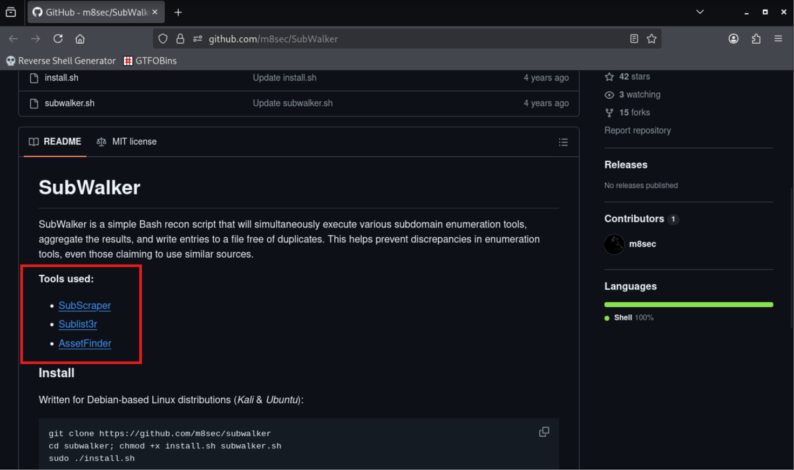
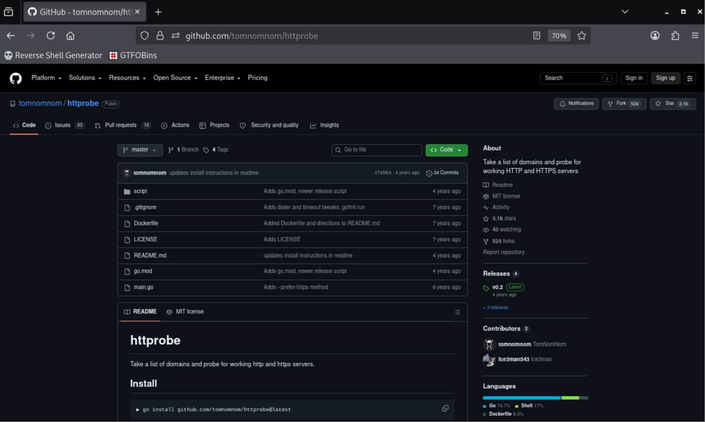
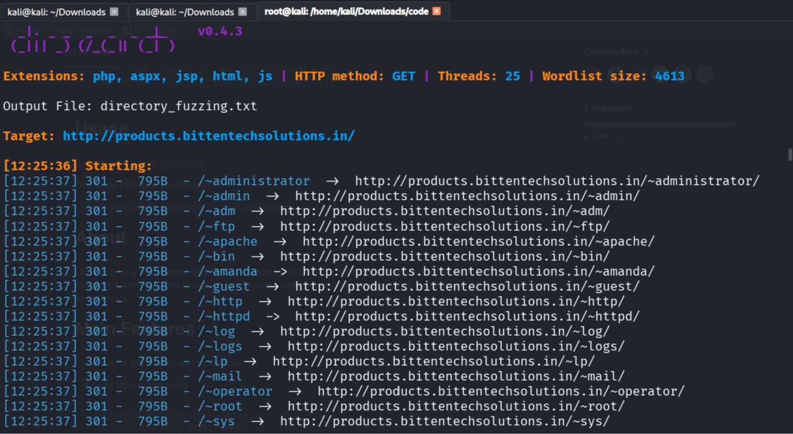
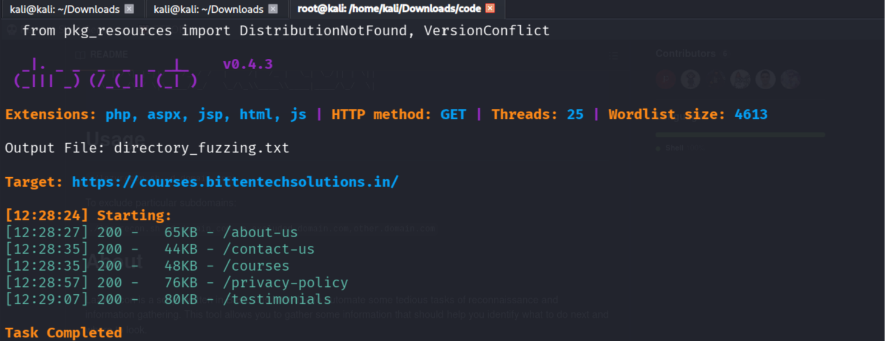

# Walkthrough — Bug Bounty Recon Automation

A step-by-step explanation of what `recon.sh` does, why each tool is used, and how to install and interpret each stage. This is the "how it works" companion to the [README](../README.md).

> **Authorized testing only.** Everything below assumes you are testing assets you own or targets explicitly in scope of a bug bounty program.

---

## Pipeline Overview

```
1. Documentation   → Create a per-target directory
2. Subdomains      → Enumerate with Sublist3r + Assetfinder
3. Sort & Filter   → Remove duplicates with sort -u
4. Resolve         → Find live hosts with httprobe
5. JS Files        → Extract JS endpoints with subjs
6. Takeover Check  → Audit with subjack
7. Directory Fuzz  → Brute-force paths with dirsearch
```

---

## 1 — Documentation Structure

Before anything, create a folder per target to keep all output organized:

```bash
target=$1

if [ ! -d "$target" ]; then
    mkdir "$target"
fi

cd "$target"
```

- `$1` = first command-line argument (the target domain)
- `-d` checks whether the directory already exists to avoid errors

> **Tip:** always quote `"$target"`. The original one-liner `if [ ! -d $target]` has two bugs — an unquoted variable and a missing space before `]` — both fixed in `recon.sh`.

---

## 2 — Subdomain Enumeration

No single tool finds every subdomain — use multiple tools and merge the results.

### Tool wrapper: SubWalker

<https://github.com/m8sec/SubWalker>



SubWalker wraps three passive enumeration tools:

- **SubScraper**
- **Sublist3r**
- **AssetFinder**

**Install:**

```bash
git clone https://github.com/m8sec/subwalker
cd subwalker
chmod +x install.sh subwalker.sh
sudo ./install.sh
```

**Usage:**

```
$ ./subwalker.sh example.com
[*] Executing SubWalker against: example.com
[*] Launching SubScraper
[*] Launching Sublist3r
[*] Launching assetfinder
[*] Waiting until all scripts complete...

[+] SubWalker complete with 10 results
[+] Output saved to: /home/kali/Downloads/subwalker/subwalker.txt
```

### Sublist3r

```
usage: sublist3r.py [-h] -d DOMAIN [-b [BRUTEFORCE]] [-p PORTS] [-v [VERBOSE]]
                    [-t THREADS] [-e ENGINES] [-o OUTPUT] [-n]

  -d, --domain DOMAIN   Domain name to enumerate subdomains of
  -t, --threads         Number of threads for the bruteforce module
  -o, --output          Save the results to a text file
```

**In the script:**

```bash
sublist3r -d "$target" -t "$THREADS" -o subdomains.txt
```

### Assetfinder

```
Usage of assetfinder:
  --subs-only   Only include subdomains of the search domain
```

**In the script** (`>>` appends to the same file):

```bash
assetfinder --subs-only "$target" >> subdomains.txt
```

---

## 3 — Sorting & Filtering

Multiple tools produce duplicate subdomains. Collapse them with `sort -u`:

```bash
sort -u subdomains.txt > subdomains
```

> **Tip:** write to a *new* file (`subdomains`) rather than appending, since this is the clean, de-duplicated list the later stages consume.

---

## 4 — Resolving Live Hosts with `httprobe`

Not every subdomain is alive. `httprobe` takes a list of domains on stdin and prints those answering on HTTP/HTTPS.

<https://github.com/tomnomnom/httprobe>



**Install:**

```bash
go install github.com/tomnomnom/httprobe@latest
```

**Basic usage:**

```
$ cat domains.txt | httprobe
http://example.com
https://example.com
```

**In the script:**

```bash
httprobe < subdomains > alive.txt
```

---

## 5 — JavaScript File Discovery with `subjs`

`subjs` fetches JavaScript file URLs referenced by a list of hosts. Analyzing JS files often reveals undocumented endpoints, API routes, and hardcoded secrets.

<https://github.com/lc/subjs>

**Install:**

```bash
go install github.com/lc/subjs@latest
```

**In the script:**

```bash
subjs < alive.txt > jsfiles
```

---

## 6 — Subdomain Takeover Check with `subjack`

<https://github.com/haccer/subjack>

> **What is a subdomain takeover?**
> When a subdomain has a CNAME record pointing to a third-party service
> (Shopify, GitHub Pages, AWS S3, etc.) and that resource is deleted or
> unclaimed, an attacker can register the unclaimed resource. Because the
> CNAME still points there, the attacker's content is served on the target's
> subdomain — a critical vulnerability.

**Install:**

```bash
go install github.com/haccer/subjack@latest
```

**Key flags:**

| Flag | Description | Default |
| ---- | ----------- | ------- |
| `-w` | Path to wordlist of subdomains | |
| `-c` | Path to `fingerprints.json` | |
| `-t` | Concurrent threads | 10 |
| `-timeout` | Seconds before connection timeout | 10 |
| `-o` | Output file (`.json` extension for JSON) | |
| `-ssl` | Force HTTPS (may improve accuracy) | false |
| `-a` | Send requests to every URL, not just those with CNAMEs | false |

**In the script:**

```bash
subjack -w subdomains -c "$SUBJACK_FINGERPRINTS" -t "$THREADS" -ssl -o takeovers.txt
```

> **Warning:** the `-c` flag must point at the real `fingerprints.json` shipped
> with subjack. A wrong path is the most common cause of errors. Locate it with
> `find / -name fingerprints.json 2>/dev/null` and set `SUBJACK_FINGERPRINTS`.

---

## 7 — Directory Fuzzing with `dirsearch`

<https://github.com/maurosoria/dirsearch>

**Install:**

```bash
sudo apt install dirsearch
```

**Loop through every live host:**

```bash
while read -r host; do
    dirsearch -u "$host" -w "$WORDLIST" -o directory_fuzzing.txt
done < alive.txt
```

---

## Sample Output

Running against `bittentechsolutions.in`:

```
$ ./recon.sh bittentechsolutions.in
 [+] Finding subdomains with Sublist3r...
[-] Total Unique Subdomains Found: 4
courses.bittentechsolutions.in
learning.bittentechsolutions.in
portal.bittentechsolutions.in
products.bittentechsolutions.in
 [+] Finding subdomains with Assetfinder...
```

**dirsearch against `products.bittentechsolutions.in`:**

```
[12:25:37] 301 - /~administrator  ->  http://products.bittentechsolutions.in/~administrator/
[12:25:37] 301 - /~admin          ->  http://products.bittentechsolutions.in/~admin/
[12:25:37] 301 - /~ftp            ->  http://products.bittentechsolutions.in/~ftp/
```



**dirsearch against `courses.bittentechsolutions.in`:**

```
[12:28:27] 200 -  65KB - /about-us
[12:28:35] 200 -  44KB - /contact-us
[12:28:35] 200 -  48KB - /courses
[12:28:57] 200 -  76KB - /privacy-policy
```



**Artifacts created:**

```
alive.txt  jsfiles  subdomains  subdomains.txt  takeovers.txt  directory_fuzzing.txt
```

---

## Other Recommended Tools

| Tool | Purpose | Link |
| ---- | ------- | ---- |
| lazyrecon | Full recon automation framework | <https://github.com/nahamsec/lazyrecon> |
| amass | In-depth DNS enumeration | <https://github.com/owasp-amass/amass> |
| subfinder | Fast passive subdomain discovery | <https://github.com/projectdiscovery/subfinder> |

---

## Quick Reference — Tools Used

| Step | Tool | Purpose | Install |
| ---- | ---- | ------- | ------- |
| 2 | Sublist3r | Passive subdomain enumeration | `apt install sublist3r` |
| 2 | Assetfinder | Passive subdomain enumeration | `go install .../assetfinder@latest` |
| 3 | `sort -u` | Deduplicate results | built-in |
| 4 | httprobe | Probe for live HTTP/HTTPS servers | `go install .../httprobe@latest` |
| 5 | subjs | Extract JS file URLs | `go install .../subjs@latest` |
| 6 | subjack | Subdomain-takeover detection | `go install .../subjack@latest` |
| 7 | dirsearch | Directory brute-forcing / fuzzing | `apt install dirsearch` |
